# VD-OPD: View-Decomposed On-Policy Distillation

Official implementation of "View-Decomposed On-Policy Distillation for Robust Reasoning in
Large Language Models": on-policy distillation in which a frozen teacher is queried under two
task-preserving prompt views at the same student-generated prefix, and the shared probability
mass of the two views defines both the target and its weight.

[](#citation)
[](pyproject.toml)
[](LICENSE)
[](https://github.com/OdurShi/vd-opd/actions/workflows/ci.yml)
[](https://github.com/astral-sh/ruff)

## Overview

In on-policy distillation the student generates its own responses and a stronger teacher
tells it how each prefix should continue. A teacher's next-token distribution can be broad
for two different reasons: several continuations are genuinely acceptable, or the
prediction depends on incidental prompt wording. VD-OPD separates the two by scoring the same
student prefix under two prompt views, the original prompt and the same prompt with a short
generic prefix such as `Problem:`.

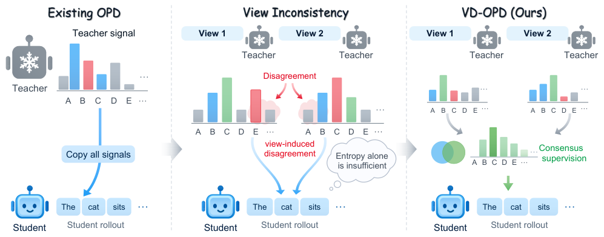

*Figure 1 of the paper. Left: matching a single teacher view can transfer prompt-sensitive
predictions. Middle: task-preserving views can disagree at the same student prefix. Right:
VD-OPD learns what both views support and reduces supervision when they disagree.*

At every response position the two teacher distributions `p1`, `p2` are combined into the
*unnormalised* geometric consensus `c = sqrt(p1 * p2)`. Its shape says what to imitate and
its total mass `Z = sum(c)` (the Bhattacharyya affinity, in `[0, 1]`) says how strongly. The
loss is `-(1/N_k) sum c^T log q`, i.e. forward-KL distillation toward `c / Z` with weight
`Z`: identical views reproduce ordinary full-weight distillation, disjoint views contribute
nothing. No answer labels are used, and inference uses the student alone.

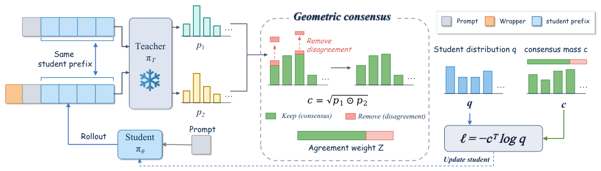

*Figure 3 of the paper. Both teacher views are evaluated at the same student prefix; teacher
predictions are detached throughout the student update.*

## Installation

Python 3.10 or newer.

```bash
# with uv
uv venv --python 3.11 .venv
uv pip install -p .venv/bin/python -e ".[dev]"

# or with pip
python -m venv .venv && source .venv/bin/activate
pip install -e ".[dev]"
```

Extras: `data` (Hugging Face `datasets`, for `scripts/download_data.py`), `accel`
(`accelerate`), `plots` (`matplotlib`), `figures` (PyMuPDF), `all`. For a CPU-only machine
install PyTorch first: `pip install torch --index-url https://download.pytorch.org/whl/cpu`.

## Quick start

The whole loop (rollout, two-view teacher scoring, consensus loss, update, evaluation over
seen and unseen prompt views) runs on a laptop CPU in a few minutes with tiny transformers
built in code and a synthetic arithmetic task:

```bash
vdopd demo                     # or: python examples/quickstart.py
vdopd demo --objective gkd_rkl # any objective from the table below
```

Output of `vdopd demo` (percent; tiny models on the synthetic task; the run is
deterministic):

```text
model                  Avg@4   Pass@4  MeanView  WorstView  WorstTmpl
---------------------------------------------------------------------
toy teacher             81.2     90.0      81.2       76.9       80.0
initial student          8.1     25.0       6.7        0.6        5.0
distilled student       38.8     82.5      15.6        5.0       13.1

loss 0.3487 -> 0.1176 over 300 iterations; mean retained mass Z = 0.998; 413 s
```

The demo first fits the tiny teacher to the synthetic task with ordinary supervised
training, then distils the student with Algorithm 1.

Using the library directly:

```python
import torch
from vdopd import geometric_consensus

log_p1 = torch.tensor([0.99, 0.01]).log()  # teacher, view 1
log_p2 = torch.tensor([0.01, 0.99]).log()  # teacher, view 2
c, Z = geometric_consensus(log_p1, log_p2)  # c = [0.0995, 0.0995], Z = 0.199
```

## Data

The datasets of the paper's experiments live in [`data/`](data/README.md); loaders read
these files and fall back to the Hugging Face Hub only when a file is absent.

| Dataset | Role | In the repository |
|---|---|---|
| MATH training split (7,500 problems) | training prompts, development and diagnostic sets | `data/math_train/train.jsonl` |
| Appendix B.1 partition (seed 42): 6,499 optimisation / 500 development / 500 diagnostic | split index files | `data/math_train/splits/` |
| MATH500, AIME25, OlympiadBench subset, GSM8K test | evaluation | `data/benchmarks/*.jsonl` |
| AMC23, AIME24, Minerva Math | evaluation | `python scripts/download_data.py` |

Sources, pinned revisions, licences, sizes and SHA-256 digests are listed in
[`data/README.md`](data/README.md). Use `--data-dir` (or `VDOPD_DATA_DIR`) to point the
loaders at another copy.

## Reproducing the paper

The paper trains on eight NVIDIA A100 80GB GPUs with BF16 model computation (Appendix B.4);
a default run takes 30-37 GPU-hours (Table 2). Models are loaded from the Hugging Face Hub
(`Qwen/Qwen3-8B`, `Qwen/Qwen3-1.7B-Base`, `Qwen/Qwen3-4B-Base`,
`meta-llama/Llama-3.1-8B-Instruct`, `meta-llama/Llama-3.2-3B-Instruct`).

One training-plus-evaluation run for the three seeds (11, 22, 33):

```bash
python scripts/download_data.py          # once: fetches AMC23, AIME24 and Minerva Math
scripts/run_experiment.sh configs/qwen3_1p7b/vdopd.yaml
# = for each seed:
#   vdopd train --config configs/qwen3_1p7b/vdopd.yaml --set train.seed=11 ...
#   vdopd eval  --config configs/qwen3_1p7b/vdopd.yaml --student runs/.../final/student \
#               --output results/qwen3_1p7b/vdopd/seed11.json
```

Reference rows: `vdopd eval --config configs/qwen3_1p7b/vdopd.yaml --output
results/qwen3_1p7b/initial_student/seed11.json` evaluates the initial student; add
`--student Qwen/Qwen3-8B` for the frozen teacher.

| Paper item | Command | Configs |
|---|---|---|
| Table 1, Table 6 (Avg@8, Pass@8, Qwen3-1.7B-Base) | `scripts/run_experiment.sh <config>` per method, then `python scripts/aggregate_results.py --results-dir results/qwen3_1p7b [--metric pass_at_k]` | `configs/qwen3_1p7b/{gkd_fkl,gkd_rkl,gkd_jsd,sampled_opd,eopd_top16,eopd_full,vdopd}.yaml` |
| Table 2 (teacher-access and total-FLOPs controls) | `scripts/run_experiment.sh <config>` | `configs/qwen3_1p7b/{eopd_full,eopd_2v,vdopd,vdopd_budget}.yaml` |
| Table 3, Table 10 (unseen wrappers) | `python scripts/aggregate_results.py --results-dir results/qwen3_1p7b --metric mean_view` (also `worst_view`, `worst_template`) | same evaluation files |
| Table 4 (target shape and weight) | `scripts/run_experiment.sh <config>` | `configs/qwen3_1p7b/ablation_{arithmetic,weighted_arithmetic,geometric,shuffled_weight,batch_mean_weight}.yaml`, `vdopd.yaml` |
| Figure 4, Tables 7-8 (other backbones) | `scripts/run_experiment.sh <config>`, then `python scripts/aggregate_results.py --results-dir results/<group> --baseline initial_student` | `configs/qwen3_4b/*.yaml`, `configs/llama3p2_3b/*.yaml` |
| Figure 2 (entropy vs. cross-view variation) | `python scripts/preliminary_study.py --config configs/qwen3_1p7b/vdopd.yaml --num-pairs 5000 --plot fig2.png` | `configs/qwen3_1p7b/vdopd.yaml` |
| Figure 5 (accuracy vs. teacher-scoring FLOPs) | `vdopd train ... --set train.max_teacher_flops=<budget>`, then `python scripts/teacher_flops_curve.py --root runs/fig5` | `configs/qwen3_1p7b/{eopd_full,vdopd}.yaml` |
| Figure 6, Table 12 (local-update utility) | `python scripts/local_update_diagnostic.py --config configs/qwen3_1p7b/vdopd.yaml --plot fig6.png` | `configs/qwen3_1p7b/vdopd.yaml` |
| Theorem 1, Lemmas 3-4, Corollaries 5-6, Propositions 7 and 9, Theorem 8 | `pytest tests/test_theory.py` | - |

The two diagnostic scripts also accept `--toy` to run on the tiny models of the quick start.
Implementation choices for details the paper leaves open are recorded in
[docs/implementation_notes.md](docs/implementation_notes.md).

### Objectives

`objective.name` in a config, or `vdopd demo --objective <name>`:

| Name | Method | Teacher views |
|---|---|---|
| `vdopd` | VD-OPD: target `c_t`, weight `Z_t` (Eq. 7) | 2 |
| `arithmetic`, `weighted_arithmetic`, `geometric` | Table 4(a) target/weight combinations | 2 |
| `shuffled_weight`, `batch_mean_weight` | Table 4(b) weight-assignment controls | 2 |
| `eopd_2v` | EOPD (full) averaged over two views (Eq. 13) | 2 |
| `eopd_full`, `eopd_top16` | sampled-token OPD + entropy-gated forward KL | 1 |
| `sampled_opd` | sampled-token OPD | 1 |
| `gkd_fkl`, `gkd_rkl`, `gkd_jsd` | GKD with forward KL, reverse KL, generalised JSD | 1 |

Further objectives plug into the same training loop through
`vdopd.objectives.register_objective`.

### Supplementary experiments

The supplementary experiments E01-E18 use the same training and evaluation commands; their
reported tables are in [docs/supplementary_results.md](docs/supplementary_results.md). In the
table below, `tables` stands for

```bash
python scripts/supplementary_tables.py --results-dir results --runs-dir runs --output-dir out/tables
```

which turns the per-seed evaluation files into CSV tables with the file and column names of
[`results/supplementary/`](results/supplementary/README.md): mean and SD over seeds, and 95%
confidence intervals from a paired question bootstrap (`vdopd/eval/bootstrap.py`).

| ID | What | Command | Configs / code |
|---|---|---|---|
| E01 | Three-seed Avg@8 per benchmark for three students, VD-OPD gain with 95% paired question bootstrap CI | `scripts/run_experiment.sh configs/qwen3_1p7b/eopd_full.yaml`, `scripts/run_experiment.sh configs/qwen3_1p7b/vdopd.yaml` (same two files in `configs/qwen3_4b/` and `configs/llama3p2_3b/`); `tables --tables E01` | `vdopd/eval/bootstrap.py` (`paired_question_bootstrap`, `seed_summary`), `vdopd/eval/tables.py` |
| E02-E04 | Complete Avg@8 / Pass@8 tables of the three students, all methods | `scripts/run_experiment.sh <config>` for every method file of a student; `scripts/evaluate_reference.sh configs/qwen3_1p7b/vdopd.yaml frozen_teacher Qwen/Qwen3-8B`; `scripts/evaluate_reference.sh configs/qwen3_1p7b/vdopd.yaml initial_student`; `tables --tables E02 E03 E04` | method files in `configs/qwen3_1p7b/`, `configs/qwen3_4b/`, `configs/llama3p2_3b/`; `vdopd/eval/evaluator.py`, `vdopd/eval/metrics.py`. ToDi-OP, TSD-KD and Veto are registration hooks |
| E05 | Teacher and Qwen3-4B students on MATH500 under one protocol | `scripts/evaluate_reference.sh configs/qwen3_4b/vdopd.yaml frozen_teacher Qwen/Qwen3-8B`; `scripts/run_experiment.sh configs/qwen3_4b/vdopd.yaml`; `tables --tables E05` | `EvalConfig` defaults, `model.expected_generation_suffix` in `configs/base_qwen3_1p7b.yaml`, `vdopd/pipeline.py` (`evaluate_student`) |
| E06 | Compute- and view-matched controls (equal total FLOPs; equal views and updates) | `scripts/run_experiment.sh configs/qwen3_1p7b/eopd_2v.yaml`; `scripts/run_experiment.sh configs/qwen3_1p7b/vdopd_budget.yaml`; `tables --tables E06` | `configs/qwen3_1p7b/eopd_full.yaml`, `eopd_2v.yaml`, `vdopd.yaml`, `vdopd_budget.yaml`; `TwoViewAverage`, `vdopd/flops.py`, `stratified_paired_bootstrap` |
| E07 | Target x weight factorial (arithmetic / geometric target; weight 1, Z, shuffled Z, batch-mean Z, state-specific Z) | `scripts/run_experiment.sh configs/qwen3_1p7b/ablation_geometric.yaml` (and the other four `ablation_*.yaml` files); `tables --tables E07` | `configs/qwen3_1p7b/ablation_*.yaml`, `vdopd.yaml`; `ConsensusObjective`, `assign_weights` |
| E08 | Two versus four teacher views, same updates or same FLOPs | `scripts/run_experiment.sh configs/qwen3_1p7b/vdopd_k4.yaml`; `scripts/run_experiment.sh configs/qwen3_1p7b/vdopd_k4_budget.yaml`; `tables --tables E08` | `objective.num_views`; `geometric_consensus(*views)`, `select_views(num_views=K)` |
| E09 | Cosine between each (original, alternative) pair's gradient and the three-pair mean gradient | `python scripts/pair_gradient_cosine.py --config configs/qwen3_1p7b/vdopd.yaml --student <checkpoint>/student --csv out/E09.csv` (`--toy` on CPU) | `vdopd/diagnostics.py` (`pair_gradient_cosines`) |
| E10 | Training view pools: simple templates, validated paraphrases, lower-quality views; mean Z | `VDOPD_OVERRIDES="views.pool_file=<views.jsonl>" scripts/run_experiment.sh configs/qwen3_1p7b/vdopd_paraphrase.yaml` (also `eopd_2v_paraphrase.yaml`, `vdopd_lowquality.yaml`, `eopd_2v_lowquality.yaml`); `tables --tables E10` | `vdopd/view_pools.py` (file schema, loader, validation), `views.pool*`, `Trainer.summary()` |
| E11 | 3 x 3 development grid over EOPD's tau and alpha; tuned configs | `python scripts/tune_eopd.py --config configs/qwen3_1p7b/eopd_full.yaml`; `scripts/run_experiment.sh configs/qwen3_1p7b/eopd_full_tuned.yaml`; `python scripts/aggregate_results.py --results-dir results/qwen3_1p7b --sd` | `configs/qwen3_1p7b/eopd_top16_tuned.yaml`, `eopd_full_tuned.yaml`, `eopd_2v_tuned.yaml`; `vdopd/tuning.py`, `tuning:` section |
| E12-E13 | Unseen-wrapper robustness: MeanView, WorstView, WorstTemplate, gaps, greedy answer flips | `VDOPD_OVERRIDES="evaluation.greedy_answers=true" scripts/run_experiment.sh configs/qwen3_1p7b/eopd_2v_studentaug.yaml`; `tables --tables E12 E13` | `configs/qwen3_1p7b/eopd_full_studentaug.yaml`, `eopd_2v_studentaug.yaml`; `vdopd/eval/metrics.py` |
| E14-E15 | StudentAug baselines and held-out families: prefix wrappers, structural changes, verified paraphrases | `VDOPD_OVERRIDES="evaluation.view_families=[prefix,structural,paraphrase] evaluation.paraphrase_file=<views.jsonl> evaluation.greedy_answers=true" scripts/run_experiment.sh configs/qwen3_1p7b/eopd_full_studentaug.yaml`; `tables --tables E14 E15` | `views.student_wrap_probability`; `STRUCTURAL_VIEWS`, `evaluation.structural_views`, `paraphrase_family` |
| E16 | Teacher diagnostics and continuation outcomes by quartile of Z | `python scripts/agreement_diagnostic.py --config configs/qwen3_1p7b/vdopd.yaml --student <checkpoint>/student --csv out/E16.csv` (`--toy` on CPU) | `vdopd/diagnostics.py` (`build_analysis_states`, `state_agreement`, `agreement_summary`) |
| E17 | Five matched local updates: oracle KL, shared-wrong probability, correctness, by Z stratum with CIs | `python scripts/local_update_diagnostic.py --config configs/qwen3_1p7b/vdopd.yaml --supplementary --checkpoint <checkpoint> --candidates <candidates.jsonl> --csv out/E17.csv` (`--toy --supplementary` on CPU) | `vdopd/diagnostics.py` (`matched_branch_updates`, `oracle_kl_decrease`, `stratum_means`) |
| E18 | Two-token example: same normalised target, Z = 1 versus Z = 0.199 | `python examples/two_token_example.py` | `vdopd/theory.py` (`two_token_example`) |

E10 and the paraphrase family of E14-E15 read externally written, validated prompt views
from a JSON Lines file (one record per problem and view; schema and checks in
`vdopd/view_pools.py`). `objective.num_views` sets the number of teacher views of the
consensus objectives, `views.student_wrap_probability` enables student-side prompt
augmentation, and `evaluation.view_families` selects the held-out view families.

## Method-to-code map

| Paper | Code |
|---|---|
| Eq. 1, JS divergence between views | `vdopd/consensus.py: js_divergence` |
| Eq. 2, App. A.1, two teacher views at the same prefix | `vdopd/scoring.py: pack_prompt_and_response, iter_log_prob_blocks` |
| Table 5, App. A.1, wrappers and validity | `vdopd/views.py: TRAIN_WRAPPERS, apply_wrapper, select_views` |
| App. B.2.2, held-out wrappers | `vdopd/views.py: EVAL_WRAPPERS` |
| Eq. 3, square-root decomposition | `vdopd/consensus.py: view_decomposition` |
| Eq. 4-5, consensus target and mass | `vdopd/consensus.py: geometric_consensus` |
| Eq. 6, generalised-KL barycentre | `vdopd/consensus.py: generalized_kl` |
| Eq. 7, consensus loss; Table 4 variants | `vdopd/objectives.py: ConsensusObjective, assign_weights` |
| Eq. 13, EOPD-2V; App. B.3 baselines | `vdopd/objectives.py: TwoViewAverage, EOPD, SampledTokenOPD, ForwardKL, ReverseKL, GeneralizedJSD` |
| Algorithm 1, App. A.2 | `vdopd/trainer.py: Trainer.train_step, collect_rollouts, accumulate_gradients, apply_update` |
| App. B.1, MATH split | `vdopd/data/math_train.py`, `scripts/make_math_splits.py` |
| App. B.4, optimizer and schedule | `vdopd/optim.py` |
| App. B.5, FLOPs accounting | `vdopd/flops.py` |
| Eq. 9, App. B.7, local-update diagnostics | `vdopd/diagnostics.py: position_statistics, matched_branch_updates, binned_utility_summary` |
| Eq. 10, Avg@8 / Pass@8 | `vdopd/eval/metrics.py: avg_at_k, pass_at_k` |
| Eq. 11-12, MeanView / WorstView / WorstTemplate | `vdopd/eval/metrics.py: view_robustness` |
| Eq. 14, seed statistics | `vdopd/eval/metrics.py: seed_mean_and_sd` |
| Eq. 15-22, target-improvement diagnostic | `vdopd/diagnostics.py: candidate_logits`, `vdopd/theory.py` |
| Section 4.4, App. D, theory | `vdopd/theory.py`, `tests/test_theory.py` |

The full map and the technical record are in
[docs/implementation_notes.md](docs/implementation_notes.md).

## Results

The tables and figures in this section are the results reported in the paper. Unless noted,
the teacher is Qwen3-8B, the student is Qwen3-1.7B-Base, and scores are three-seed means in
percent.

**Results from the paper (Table 1): mathematical reasoning, zero-shot Avg@8.**

| Category | Method | MATH500 | AMC23 | AIME24 | AIME25 | Minerva | Olymp. | Mean |
|---|---|---|---|---|---|---|---|---|
| Reference models | Frozen teacher | 72.8 | 51.4 | 16.7 | 12.5 | 38.6 | 43.1 | 39.2 |
| | Initial student | 54.7 | 32.8 | 8.3 | 5.1 | 25.4 | 30.2 | 26.1 |
| Standard distillation | GKD-FKL | 58.9 | 36.1 | 9.7 | 6.2 | 27.8 | 33.0 | 28.6 |
| | GKD-RKL (full) | 59.6 | 36.8 | 10.1 | 6.5 | 28.4 | 33.7 | 29.2 |
| | GKD-JSD | 60.1 | 37.5 | 10.4 | 6.9 | 28.9 | 34.2 | 29.7 |
| | Sampled-token OPD | 62.4 | 39.8 | 11.7 | 7.8 | 30.7 | 36.0 | 31.4 |
| Adaptive supervision | ToDi-OP | 63.1 | 40.5 | 12.4 | 8.3 | 31.5 | 36.8 | 32.1 |
| | TSD-KD | 63.8 | 41.2 | 12.8 | 8.9 | 32.1 | 37.5 | 32.7 |
| | EOPD (top-16) | 65.1 | 42.8 | 13.9 | 9.9 | 33.7 | 39.1 | 34.1 |
| | EOPD (full) | 66.0 | 43.6 | 14.4 | 10.4 | 34.5 | 40.0 | 34.8 |
| Target reformulation | Veto | 64.2 | 41.7 | 13.1 | 9.2 | 32.8 | 38.0 | 33.2 |
| | **VD-OPD** | **67.8** | **45.9** | **15.8** | **11.7** | **36.9** | **42.1** | **36.7** |

**Results from the paper (Figure 4): gains over the initial student on MATH500 for three
student backbones.**

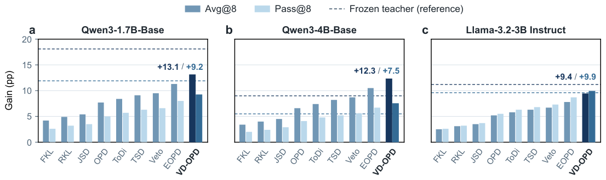

**Results from the paper (Table 2): teacher-access and total-compute controls.**

| Method | Views | FLOPs (1e18) | GPU-h | MATH500 Avg@8 | MATH500 Pass@8 | Six-math Avg@8 | Six-math Pass@8 |
|---|---|---|---|---|---|---|---|
| *Matched total FLOPs* | | | | | | | |
| EOPD (full) | 1 | 4.7 | 30.3 | 66.0 | 87.5 | 34.8 | 55.5 |
| VD-OPD-Budget | 2 | 4.7 | 30.5 | **67.0** | **88.2** | **36.0** | **57.0** |
| *Matched two-view access and rollout/update counts* | | | | | | | |
| EOPD-2V | 2 | 5.8 | 37.0 | 66.5 | 87.9 | 35.3 | 56.1 |
| VD-OPD | 2 | 5.8 | 37.2 | **67.8** | **88.7** | **36.7** | **57.6** |

**Results from the paper (Figure 5): accuracy versus teacher-scoring computation.**

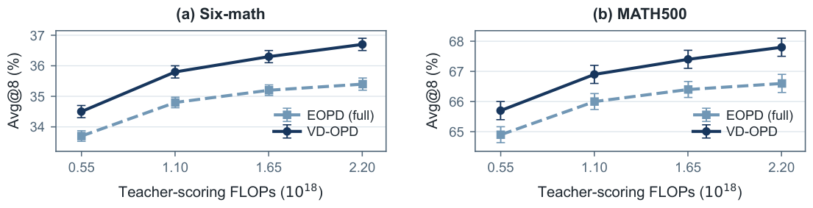

**Results from the paper (Table 3): robustness to unseen prompt wrappers (macro-average over
the six mathematics benchmarks) and cross-domain accuracy.**

| Method | Mean view | Worst view | Worst template | GPQA-Diamond | MMLU-Pro |
|---|---|---|---|---|---|
| Frozen teacher | 35.8 | 32.4 | 33.1 | 42.1 | 51.7 |
| Initial student | 25.9 | 21.8 | 22.7 | 34.5 | 41.8 |
| GKD-FKL | 28.1 | 23.6 | 24.5 | 35.9 | 43.0 |
| Sampled-token OPD | 30.0 | 25.8 | 26.7 | 36.9 | 44.2 |
| ToDi-OP | 30.9 | 26.7 | 27.8 | 37.5 | 44.8 |
| TSD-KD | 31.5 | 27.3 | 28.5 | 38.0 | 45.3 |
| EOPD (full) | 32.8 | 28.9 | 30.1 | 39.1 | 46.7 |
| Veto | 31.9 | 27.9 | 29.0 | 38.4 | 45.8 |
| **VD-OPD** | **33.7** | **30.2** | **31.1** | **40.6** | **48.2** |

**Results from the paper (Table 4): target-shape and weight ablation.**

| Configuration | Target | Weight | MATH500 Avg@8 | MATH500 Pass@8 | Six-math Avg@8 | Six-math Pass@8 |
|---|---|---|---|---|---|---|
| Arithmetic | arithmetic mean | 1 | 66.1 | 87.8 | 35.0 | 56.1 |
| Weighted arithmetic | arithmetic mean | `Z_t` | 66.8 | 88.1 | 35.7 | 56.8 |
| Geometric | `c_t / Z_t` | 1 | 67.2 | 88.4 | 36.1 | 57.2 |
| **VD-OPD** | `c_t / Z_t` | `Z_t` | **67.8** | **88.7** | **36.7** | **57.6** |
| Shuffled weight | `c_t / Z_t` | `Z_pi(t)` | 67.3 | 88.5 | 36.2 | 57.3 |
| Batch-mean weight | `c_t / Z_t` | batch mean of `Z_t` | 67.5 | 88.6 | 36.4 | 57.4 |

**Results from the paper (Figures 2 and 6): teacher entropy versus cross-view variation
across 5,000 paired predictions, and consensus mass versus local consensus-fit utility.**

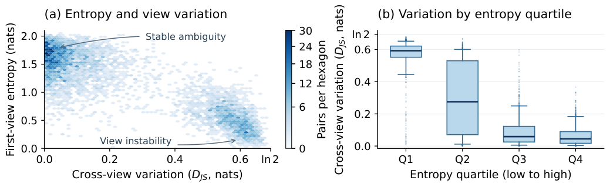

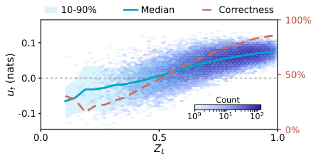

All figures of the paper, with their captions, are in
[`assets/paper_figures/`](assets/paper_figures/README.md). Example outputs of the
reduced-scale configurations (`configs/reduced_scale/`) are in
[`results/reduced_scale/`](results/reduced_scale/).

### Supplementary results

Supplementary experiments E01-E18 extend the tables above with seed variation, 95% confidence
intervals, compute- and view-matched controls, further ablations, prompt-robustness tests and
an analysis of the cross-view agreement `Z`. They are results reported by the authors. The
numbers are stored as CSV files in [`results/supplementary/`](results/supplementary/README.md),
all eighteen tables with their setup and key findings are in
[docs/supplementary_results.md](docs/supplementary_results.md), and the figures below are drawn
from the CSV files by `scripts/plot_supplementary.py`. SD is across three training seeds;
confidence intervals use a paired question bootstrap.

**Supplementary results (E01): gain of VD-OPD over EOPD (full) in Avg@8 for three students,
with 95% confidence intervals.**

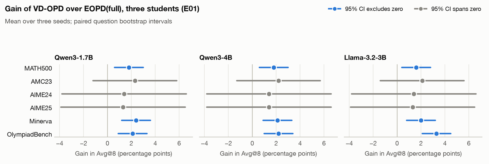

**Supplementary results (E02-E04): macro Avg@8 over the six benchmarks for every method and
student (complete Tables 6-8).**

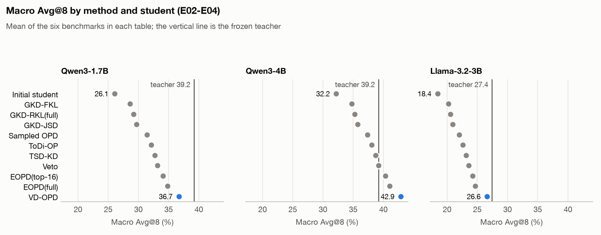

**Supplementary results (E06): controls matched in total FLOPs and in teacher views and
updates (extends Table 2).**

<!-- supplementary:E06 -->
| Comparison | Budget matched | Baseline FLOPs (1e18) | VD FLOPs (1e18) | Baseline Macro Avg@8 (mean ± SD) | VD Macro Avg@8 (mean ± SD) | VD gain [95% CI] |
|---|---|---:|---:|---:|---:|---:|
| EOPD(full) vs. VD-Budget | equal total FLOPs | 4.7 | 4.7 | 34.82 ± 0.62 | 36.00 ± 0.62 | +1.2 [+0.2, +2.2] |
| EOPD(2V) vs. VD-OPD | equal two-view / update budget | 5.8 | 5.8 | 35.30 ± 0.63 | 36.70 ± 0.62 | +1.4 [+0.4, +2.4] |
| EOPD(full) vs. VD-OPD | none (unmatched) | 4.7 | 5.8 | 34.82 ± 0.62 | 36.70 ± 0.62 | +1.9 [+0.9, +2.9] |
<!-- /supplementary:E06 -->

**Supplementary results (E07): target and weight ablation with seed variation (extends
Table 4).**

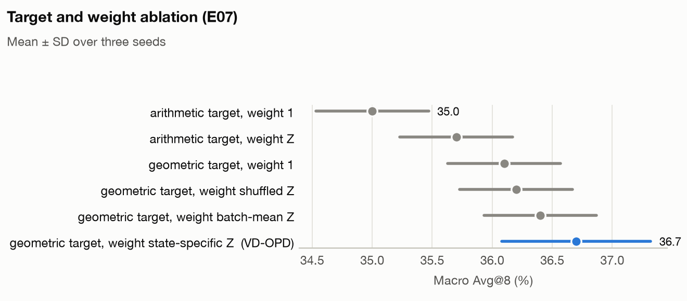

**Supplementary results (E08): two versus four teacher views.**

<!-- supplementary:E08 -->
| Views / budget | Macro Avg@8 (mean ± SD) | WorstView | FLOPs (1e18) | GPU-h | Gain over K=2 [95% CI] |
|---|---:|---:|---:|---:|---:|
| K=2 | 36.7 ± 0.62 | 30.2 | 5.8 | 37.2 | - |
| K=4, same updates | 37.1 ± 0.65 | 30.6 | 8.0 | 51.3 | +0.4 [−0.3, +1.1] |
| K=4, same FLOPs | 36.3 ± 0.70 | 30.0 | 5.8 | 37.5 | −0.4 [−1.2, +0.4] |
<!-- /supplementary:E08 -->

**Supplementary results (E10): sensitivity to the training view pool.**

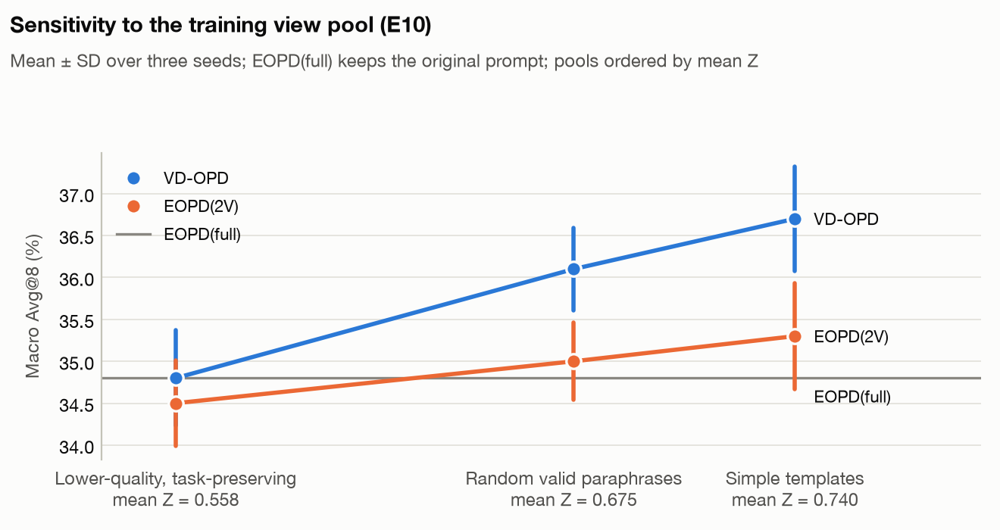

**Supplementary results (E14): accuracy on held-out prompt views, with student-side prompt
augmentation baselines.**

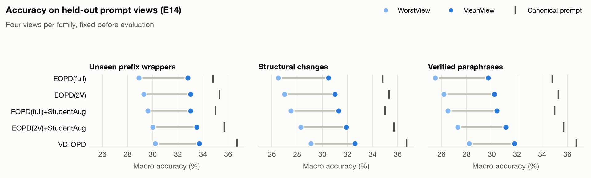

**Supplementary results (E17): effect of one matched update in the low- and high-agreement
quartiles.**

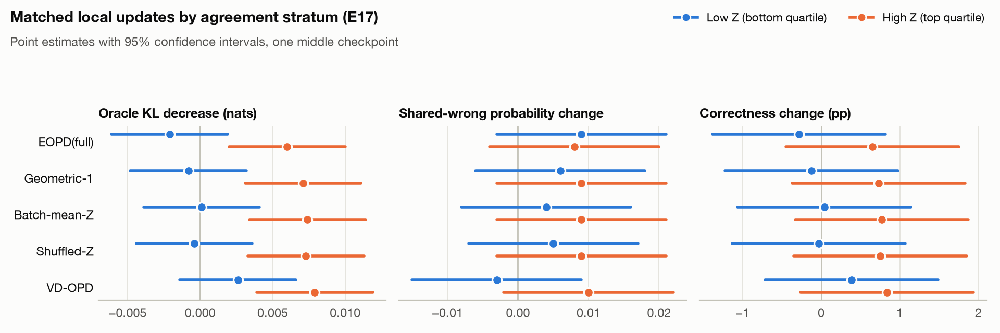

## Repository structure

```text
.
├── assets/
│   ├── paper_figures/            figures of the paper (fig01.png ... fig06.png) and captions
│   └── supplementary/            figures drawn from the supplementary tables
├── configs/
│   ├── base_qwen3_1p7b.yaml      common protocol (Section 5.1, Appendix A.2, B.1-B.4)
│   ├── qwen3_1p7b/               one file per method, control and ablation (Tables 1-4, E06-E14)
│   ├── qwen3_4b/, llama3p2_3b/   other backbones (Tables 7-8, Figure 4, E03-E04)
│   └── reduced_scale/            small public models on the synthetic task
├── data/                         MATH training split, Appendix B.1 partition, benchmarks
├── docs/
│   ├── implementation_notes.md   paper-to-code map, implementation choices, technical record
│   └── supplementary_results.md  the eighteen supplementary tables (generated)
├── examples/
│   ├── quickstart.py             CPU quick start (same as `vdopd demo`)
│   └── two_token_example.py      E18: same normalised target, different consensus mass
├── results/
│   ├── reduced_scale/            example outputs of the reduced-scale configurations
│   └── supplementary/            reported tables E01-E18 as CSV, with index.yaml
├── scripts/
│   ├── run_experiment.sh         train + evaluate one config for seeds 11/22/33
│   ├── evaluate_reference.sh     evaluate a fixed model (teacher, initial student) per seed
│   ├── aggregate_results.py      result tables from evaluation files
│   ├── supplementary_tables.py   tables E01-E15 (seed SD, bootstrap CIs) from evaluation files
│   ├── render_supplementary.py   results/supplementary -> docs and README tables, with checks
│   ├── plot_supplementary.py     results/supplementary -> assets/supplementary
│   ├── tune_eopd.py              E11: development grid over EOPD's tau and alpha
│   ├── pair_gradient_cosine.py   E09
│   ├── agreement_diagnostic.py   E16
│   ├── local_update_diagnostic.py  Figure 6, Table 12, E17
│   ├── preliminary_study.py      Figure 2
│   ├── teacher_flops_curve.py    Figure 5
│   ├── download_data.py          fetch datasets into data/
│   ├── make_math_splits.py       Appendix B.1 partition as index files
│   └── extract_paper_figures.py  crop the paper figures from the PDF
├── src/vdopd/
│   ├── consensus.py              Eq. 1, 3-6: view decomposition, consensus target, mass (K views)
│   ├── objectives.py             Eq. 7, 13, Table 4: VD-OPD, ablations, baselines
│   ├── views.py, chat.py         prompt wrappers, held-out view families, chat serialisation
│   ├── view_pools.py             externally written prompt views: schema, loader, validation
│   ├── scoring.py                response-token alignment, blockwise log-probabilities
│   ├── trainer.py                Algorithm 1
│   ├── models.py                 causal-LM adapter (hidden states / output head / sampling)
│   ├── optim.py, flops.py, seeding.py, config.py, pipeline.py, cli.py, tuning.py
│   ├── diagnostics.py, theory.py Section 3, 4.4, 5.5; Appendix B.7, B.8, D; E09, E16-E18
│   ├── supplementary.py          loader, renderer and consistency checks for the reported tables
│   ├── data/                     dataset loaders, MATH split, synthetic task
│   ├── eval/                     answer checking, metrics, evaluator, bootstrap, result tables
│   └── demo.py                   synthetic quick start
└── tests/                        unit, gradient, alignment, data, table and end-to-end tests
```

## Citation

The paper is under double-blind review; the BibTeX entry will be added on publication.

## License

The code is released under the MIT License, see [LICENSE](LICENSE). The datasets in `data/`
keep their own licences, see [data/README.md](data/README.md).

## Acknowledgements

- Built on [PyTorch](https://pytorch.org) (BSD-3-Clause) and Hugging Face
  [Transformers](https://github.com/huggingface/transformers) and
  [Datasets](https://github.com/huggingface/datasets) (Apache-2.0); symbolic answer checks
  use [SymPy](https://www.sympy.org) (BSD-3-Clause).
- Models named in the configs: Qwen3 (Apache-2.0), Llama 3.1 / 3.2 (Llama Community
  Licenses), SmolLM2 (Apache-2.0).
- Datasets: MATH and MATH500 (MIT), GSM8K (MIT), OlympiadBench (Apache-2.0 / MIT), AIME25,
  AMC23, AIME24 and Minerva Math; sources and licence texts are in
  [data/README.md](data/README.md).
- The answer normalisation follows the conventions of the MATH benchmark's reference
  evaluation.
